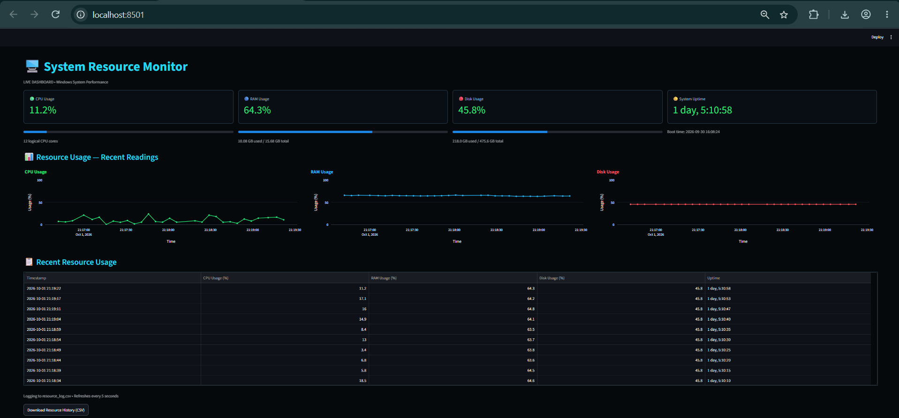
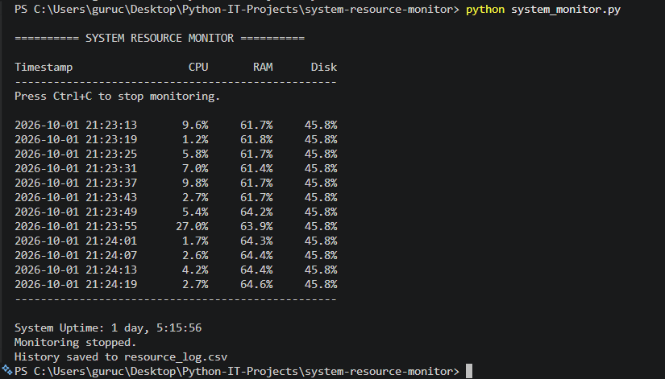

# System Resource Monitor — Python Live Dashboard

A Python-based system monitoring application that tracks CPU usage, RAM usage, disk utilization, and system uptime. It provides two interfaces: a command-line monitoring tool and a live web dashboard built with Streamlit.

The dashboard displays resource metrics, historical charts, threshold-based warnings, and recent monitoring records. Resource measurements are saved in a CSV file for later analysis.

## Table of Contents

- [Project Overview](#project-overview)
- [Project Objectives](#project-objectives)
- [Features](#features)
- [Dashboard Screenshots](#dashboard-screenshots)
- [Technologies Used](#technologies-used)
- [Project Structure](#project-structure)
- [System Requirements](#system-requirements)
- [Installation and Setup](#installation-and-setup)
- [How to Run the Project](#how-to-run-the-project)
- [How the Project Works](#how-the-project-works)
- [Understanding the Metrics](#understanding-the-metrics)
- [Alert System](#alert-system)
- [CSV Logging](#csv-logging)
- [Testing the Project](#testing-the-project)
- [Limitations](#limitations)
- [Future Enhancements](#future-enhancements)
- [Learning Outcomes](#learning-outcomes)
- [Author](#author)

## Project Overview

The System Resource Monitor is designed to help users understand how their computer uses its hardware resources while running applications.

It collects system performance information using Python and the `psutil` library. The information can be viewed in the terminal or through a browser-based dashboard.

The dashboard is developed using Streamlit and Plotly. It automatically refreshes every five seconds, displaying updated measurements and charts.

The application also records resource usage in a CSV file, allowing users to review previously collected measurements.

## Project Objectives

The main objectives of this project are:

- Monitor CPU, RAM, and disk usage.
- Display current system performance information.
- Calculate and display system uptime.
- Provide a terminal-based monitoring interface.
- Build a visual dashboard for real-time system monitoring.
- Display warnings when resource usage reaches configured thresholds.
- Record resource measurements with timestamps.
- Visualize recent resource usage through charts.
- Provide downloadable monitoring history.

## Features

### 1. CPU Monitoring

- Displays current CPU utilization as a percentage.
- Shows the number of logical CPU cores.
- Visualizes recent CPU usage through a line chart.
- Helps identify periods of increased processor activity.

### 2. RAM Monitoring

- Displays RAM utilization as a percentage.
- Shows used memory and total memory in gigabytes.
- Displays a visual usage indicator.
- Tracks changes in memory consumption over time.

### 3. Disk Monitoring

- Displays disk space utilization as a percentage.
- Shows used and total disk capacity.
- Visualizes recent disk usage measurements.
- Helps users understand available storage capacity.

The current implementation monitors the disk path selected by the application, which is typically the Windows system drive (`C:\`).

### 4. System Uptime

- Displays how long the computer has been running since its last boot.
- Shows the system boot time.
- Updates the displayed uptime while monitoring continues.

### 5. Live Web Dashboard

The browser dashboard provides:

- CPU, RAM, disk, and uptime metric cards.
- Visual usage indicators.
- Three resource usage charts.
- A recent resource usage table.
- Automatic refresh every five seconds.
- Threshold-based warning messages.
- A CSV download button.

### 6. Command-Line Monitoring

The terminal version provides a simple text-based interface showing:

- Timestamp
- CPU usage
- RAM usage
- Disk usage
- System uptime
- Monitoring status

The terminal monitor can be stopped using `Ctrl+C`.

### 7. Resource History

The application stores measurements in `resource_log.csv`.

The CSV file includes timestamps, resource utilization percentages, and system uptime. The dashboard uses this data to display recent readings and historical trends.

### 8. Threshold-Based Alerts

The dashboard checks CPU, RAM, and disk usage against configurable threshold values.

When a measurement reaches or exceeds its configured threshold, a warning appears on the dashboard.

## Dashboard Screenshots

### Live Browser Dashboard

The dashboard presents system metrics, usage charts, and recent resource readings in a single interface.



### Command-Line Monitoring Output

The terminal interface displays timestamped measurements in a readable table and reports when monitoring stops.



**Note:** Save the browser screenshot as `dashboard-screenshot.png` and the terminal screenshot as `terminal-screenshot.png` in the project root directory.

## Technologies Used

| Technology | Purpose |
|---|---|
| Python | Core programming language |
| psutil | Collects CPU, memory, disk, and boot-time information |
| Streamlit | Builds the browser-based dashboard |
| Plotly | Creates interactive resource usage charts |
| pandas | Reads and processes CSV monitoring history |
| streamlit-autorefresh | Refreshes the dashboard at regular intervals |
| CSV | Stores monitoring measurements |
| Visual Studio Code | Development environment |
| Git and GitHub | Version control and project hosting |

## Project Structure

```text
system-resource-monitor/
│
├── system_monitor.py
│   └── Command-line monitoring application
│
├── dashboard.py
│   └── Streamlit live dashboard
│
├── resource_log.csv
│   └── Recorded system resource measurements
│
├── requirements.txt
│   └── Python dependency list
│
├── README.md
│   └── Project documentation
│
├── dashboard-screenshot.png
│   └── Browser dashboard screenshot
│
├── terminal-screenshot.png
│   └── Terminal monitoring screenshot
│
└── .gitignore
    └── Files excluded from Git tracking
```

## System Requirements

- Windows 10 or Windows 11.
- Python 3 installed.
- pip package manager.
- Visual Studio Code or another Python editor.
- A modern web browser.
- Internet access for the initial installation of Python dependencies.

After installing the dependencies, the application can monitor the local computer without requiring an external monitoring service.

## Installation and Setup

### Step 1: Open the project folder

Open the project folder in Visual Studio Code.

Open the integrated terminal using **Terminal → New Terminal**.

Example project directory:

```powershell
cd "$env:USERPROFILE\Desktop\Python-IT-Projects\system-resource-monitor"
```

If your project is stored in another directory, change the path accordingly.

### Step 2: Create a virtual environment (recommended)

```powershell
python -m venv .venv
```

Activate the environment in PowerShell:

```powershell
.venv\Scripts\Activate.ps1
```

A virtual environment keeps this project's Python dependencies separate from other projects.

If PowerShell prevents environment activation, you can use your existing Python environment instead.

### Step 3: Install the dependencies

Ensure that `requirements.txt` contains:

```text
psutil
streamlit
streamlit-autorefresh
pandas
plotly
```

Install the required libraries:

```powershell
python -m pip install -r requirements.txt
```

Alternatively, install them directly:

```powershell
python -m pip install psutil streamlit streamlit-autorefresh pandas plotly
```

### Step 4: Verify the installation

Check the Python version:

```powershell
python --version
```

Check that Streamlit is available:

```powershell
python -m streamlit --version
```

## How to Run the Project

The project provides two ways to monitor system resources.

### Option 1: Run the live browser dashboard

From the project directory, execute:

```powershell
python -m streamlit run dashboard.py
```

After starting, Streamlit displays a local URL similar to:

```text
http://localhost:8501
```

Open this address in your browser.

The dashboard displays current CPU, RAM, disk, and uptime information, along with charts and recent resource history.

**Important:** Keep the terminal running while using the dashboard. Press `Ctrl+C` in the terminal to stop the Streamlit server.

### Option 2: Run the command-line monitor

Execute:

```powershell
python system_monitor.py
```

The terminal displays resource readings in a formatted table.

Example:

```text
========== SYSTEM RESOURCE MONITOR ==========

Timestamp            CPU      RAM      Disk
------------------------------------------------
2026-10-01 21:23:13   9.6%     61.7%    45.8%
2026-10-01 21:23:19   1.2%     61.8%    45.8%
2026-10-01 21:23:25   5.8%     61.7%    45.8%

------------------------------------------------
System Uptime: 1 day, 5:15:56
Monitoring stopped.
History saved to resource_log.csv
```

The values above are illustrative examples of the output format; actual readings depend on the computer.

Press `Ctrl+C` to stop monitoring.

## How the Project Works

### Step 1: Collect system information

The application uses `psutil` to retrieve CPU, RAM, disk, and boot-time information from the local operating system.

### Step 2: Calculate system uptime

The application obtains the system boot timestamp and calculates elapsed time using the current system time.

### Step 3: Display the measurements

The command-line version prints the measurements in the terminal. The dashboard presents the same categories of information through metric cards, charts, and a table.

### Step 4: Check the thresholds

The dashboard compares the latest CPU, RAM, and disk measurements with their configured threshold values.

If a measurement reaches or exceeds its threshold, a warning is displayed.

### Step 5: Save monitoring history

The measurements are written to `resource_log.csv`, which provides a record of the monitoring results.

### Step 6: Refresh the dashboard

Streamlit reruns the dashboard script at the configured refresh interval. New measurements are collected, logged, and displayed.

The dashboard refresh interval is five seconds. Because CPU measurement itself takes a short sampling interval, the exact time between recorded rows can vary slightly.

## Understanding the Metrics

### CPU Usage

CPU usage indicates how much processor capacity is being used during the measurement interval.

Higher values may occur when applications compile code, process data, load web pages, or perform other demanding tasks.

### RAM Usage

RAM usage indicates how much physical memory is currently in use.

Opening more applications or browser tabs may increase memory usage. High memory utilization does not automatically mean the computer has a problem; available memory and system performance should also be considered.

### Disk Usage

Disk usage indicates the proportion of storage capacity currently occupied on the monitored drive.

For example, a reading of 45.8% means approximately 45.8% of that drive's reported capacity is used.

### System Uptime

System uptime indicates the time elapsed since the last system boot. It is different from the time the monitoring application has been running.

### Resource Usage Charts

The dashboard plots recent measurements over time. CPU readings often fluctuate, while disk usage may remain nearly constant over short periods.

The charts use saved CSV measurements, so existing history may be displayed when the dashboard starts.

## Alert System

The default threshold settings in `dashboard.py` are:

```python
CPU_THRESHOLD = 80
RAM_THRESHOLD = 80
DISK_THRESHOLD = 90
```

The thresholds represent percentages.

| Resource | Threshold | Warning condition |
|---|---:|---|
| CPU | 80% | CPU usage is 80% or higher |
| RAM | 80% | RAM usage is 80% or higher |
| Disk | 90% | Disk usage is 90% or higher |

For example, if CPU usage reaches 85% and the CPU threshold is 80%, the dashboard displays a CPU warning.

To test the alert feature, the thresholds can temporarily be lowered. After testing, restore the normal settings.

The current alert implementation displays warnings inside the browser dashboard. It does not send Windows desktop notifications, emails, or SMS messages.

## CSV Logging

The file `resource_log.csv` stores monitoring history.

The columns are:

```text
Timestamp,CPU Usage (%),RAM Usage (%),Disk Usage (%),Uptime
```

Each row represents one collected measurement.

The dashboard reads this file to display historical readings, and the download button allows users to export the recorded data.

**Note:** The CSV file can contain local usage history. If you do not want to publish that history, add `resource_log.csv` to `.gitignore` before uploading the project to GitHub.

## Testing the Project

The project was tested by running both the terminal application and the browser dashboard on Windows.

The observed functionality included:

- Displaying CPU, RAM, and disk usage.
- Showing system uptime.
- Printing formatted measurements in the terminal.
- Displaying resource metrics in the dashboard.
- Updating dashboard measurements and charts.
- Recording readings in `resource_log.csv`.
- Displaying threshold warnings after lowering the configured test thresholds.

Resource values depend on the computer's current workload, installed memory, and storage capacity.

## Limitations

- The application monitors the local computer on which it runs.
- The dashboard refreshes periodically rather than continuously sampling every instant.
- Short-lived resource spikes may occur between measurements.
- Alerts are displayed in the dashboard only.
- Disk monitoring currently targets the configured system drive rather than providing a selector for all drives.
- CSV history can grow over time because the application continues appending readings.
- The project is intended for basic local monitoring and learning, not as a replacement for enterprise monitoring software.

## Future Enhancements

Potential future improvements include:

- Windows desktop notifications for high resource usage.
- Email alerts for configured thresholds.
- A dashboard control panel for changing thresholds.
- Monitoring multiple disk drives.
- Process-level CPU and memory usage.
- Configurable sampling intervals.
- Date-range filters for historical charts.
- Daily and weekly resource usage reports.
- CSV log rotation and automatic cleanup.
- Packaging the application for easier installation.

## Learning Outcomes

This project provides practical experience with:

- Python programming and functions.
- Operating-system resource monitoring.
- CPU, memory, disk, and uptime metrics.
- Working with third-party Python libraries.
- Data logging and CSV file handling.
- Data processing with pandas.
- Interactive visualization with Plotly.
- Building browser dashboards with Streamlit.
- Implementing threshold-based warning logic.
- Testing, debugging, and documenting an application.

These concepts are relevant to entry-level System Engineer, IT Support, and infrastructure monitoring work.

## Author

**Guru Chandrayudu**

Project: System Resource Monitor — Python Live Dashboard
